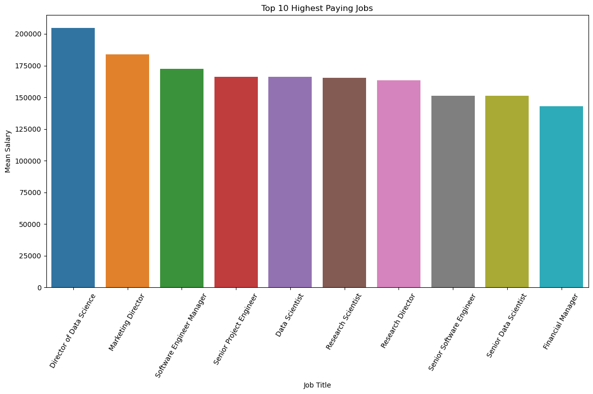
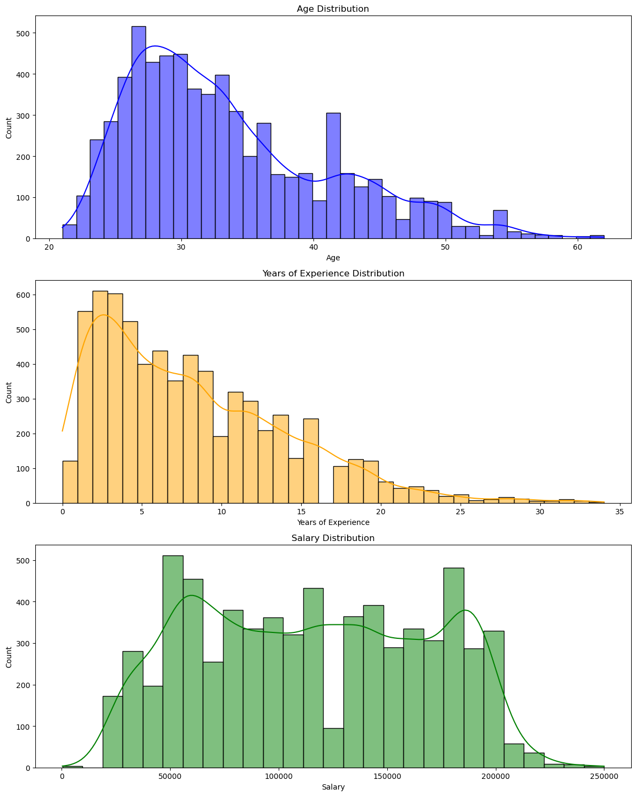
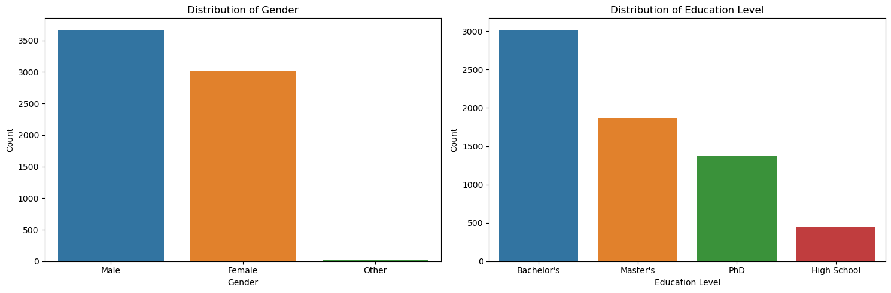
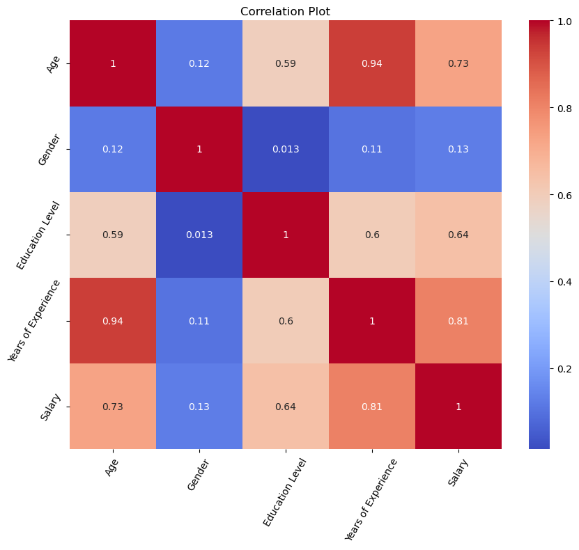
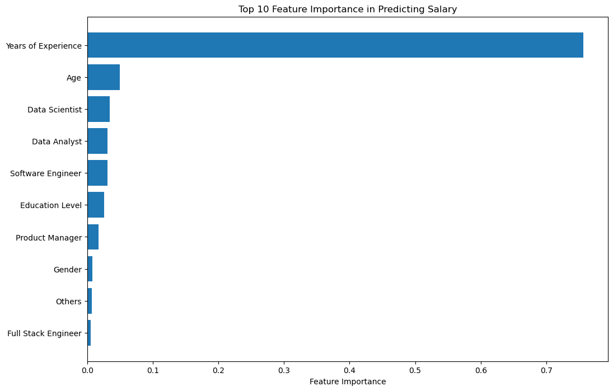

# Salary Prediction

## Introduction
This project aims to predict salaries based on various factors, such as age, gender, education level, job title, and years of experience. We have used a dataset containing 6704 rows and 6 columns to develop and evaluate our salary prediction model.

## Data Preprocessing

### Handling Missing Values
We checked for missing values in the dataset and removed rows with missing data, ensuring a clean dataset for modeling.

## Data Visualization

### Top 10 Highest Earning Professions

*A Bar plot depicting the highest paying job titles versus the mean salary.*

### Distribution of Continuous Variables

*This histogram shows the distribution of continuous variables in the dataset.*

### Distribution of Education and Gender

*A plot displaying the Education Level and Gender.*

### Correlation Heatmap

*A heatmap illustrating the correlation between different features.*

## Model Building and Evaluation

### Model Selection
We explored various machine learning algorithms, including Linear Regression, Decision Trees, and Random Forests, to build our salary prediction model. Hyperparameter tuning was performed using GridSearchCV to find the best model configuration.

### Model Evaluation

Each model's performance was evaluated using several regression metrics, including Mean Squared Error (MSE), Mean Absolute Error (MAE), Root Mean Squared Error (RMSE), and R-squared (R2) score. These metrics help assess the accuracy and reliability of the predictions.

### Feature Importance

*A bar chart depicting the importance of different features in predicting salary.*

## Results

1. The Random Forest model achieved the highest R-squared score and the lowest error metrics (MSE, MAE, RMSE), indicating superior predictive performance compared to the other models.
2. The Decision Tree model also performed well but had higher errors than the Random Forest.
3. The Linear Regression model, while simple, had the lowest R-squared score and the highest errors, suggesting limitations in capturing complex relationships.

## Conclusion

In conclusion, the Random Forest model demonstrated the best predictive capability for salary estimation in this dataset. Its feature importance analysis revealed the most influential factors.

The model evaluation and feature importance analysis provided valuable insights for understanding salary determinants and highlighted the importance of choosing the appropriate machine learning model for regression tasks.

This salary prediction model can be used to make informed salary estimates based on individual characteristics, making it a valuable tool for HR analytics and compensation planning.In conclusion, our salary prediction model, trained on a well-preprocessed dataset, successfully predicts salaries based on various factors. This project demonstrates the importance of data preprocessing, feature engineering, and model selection in creating an accurate predictive model.

## Usage

To use our salary prediction model, you can follow these steps:

1. Clone this repository.
2. Install the required libraries listed in the `requirements.txt` file.
3. Run the provided Jupyter notebook or Python script to load the model and make predictions on new data.

## Reproducibility and Validation

Keep a held-out test set separate from model selection and hyperparameter tuning. Compare candidate regressors using MAE, RMSE, and R-squared, and inspect residuals and predicted-versus-actual plots. Record the actual values produced by the notebook rather than relying on illustrative claims.

## Data Considerations

Salary data can contain missing values, inconsistent job titles, and differences across location, seniority, and experience. Document cleaning decisions and consider whether sensitive or potentially unfair attributes are appropriate for the intended analysis.

## Project Development Notes

Keep a held-out test set separate from tuning. Report MAE, RMSE, and R-squared from the actual run, inspect residuals, and document how missing salary and experience values were handled.

For reproducible updates, record the dataset or upstream version, environment and dependency versions, configuration, and actual outputs from each run. Keep illustrative examples clearly labelled and never commit credentials or private data.

### Technical Deep Dive

Keep the final test set separate from GridSearchCV so the reported result is not biased by hyperparameter selection. Use a preprocessing-and-regression Pipeline, compare Linear Regression and tree ensembles on the same folds, and inspect residuals by job title and experience range. Report MAE/RMSE in the salary dataset's actual currency and pay-period units.

Document how missing values and rare job titles are handled. Consider whether sensitive attributes are appropriate for the intended analysis, and avoid presenting feature importance as proof of causation.

## Reproducibility and Responsible Interpretation

- Document the dataset source, collection date, salary currency, pay period, and definitions of education, job title, and experience.
- Fit imputers, encoders, and feature transformations on training data only; use a held-out test set for final evaluation.
- Report actual MAE, RMSE, and R-squared values and compare them with a simple baseline.
- Inspect residuals across job titles and experience ranges to identify uneven error patterns.
- Salary estimates are dataset-dependent and should not be interpreted as guaranteed compensation or evidence of causal effects.

## Regression Engineering Notes

- Define the salary target, currency, pay period, and feature units before training.
- Compare a simple baseline with regression models using a held-out test set.
- Use MAE and RMSE to express prediction error in salary units, and report R-squared as a complementary metric.
- Fit encoders, imputers, and scalers inside a pipeline to avoid leakage.
- Inspect residuals and document dataset coverage; salary predictions are estimates and may not generalize across regions or roles.
